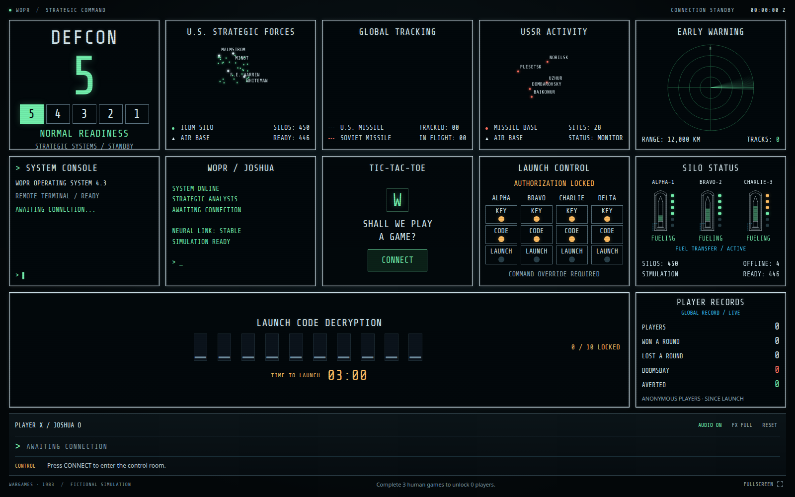
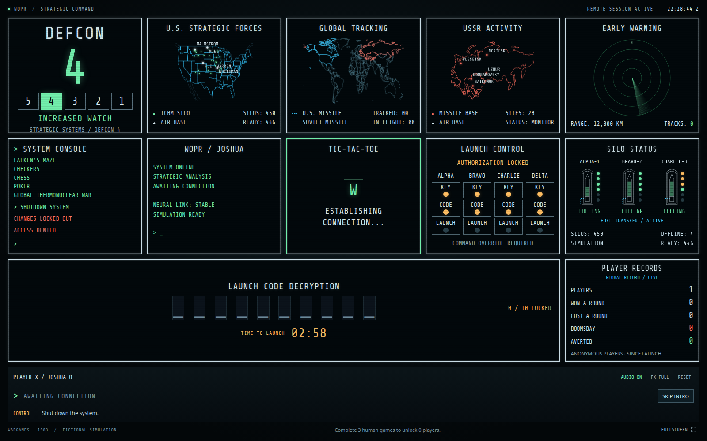
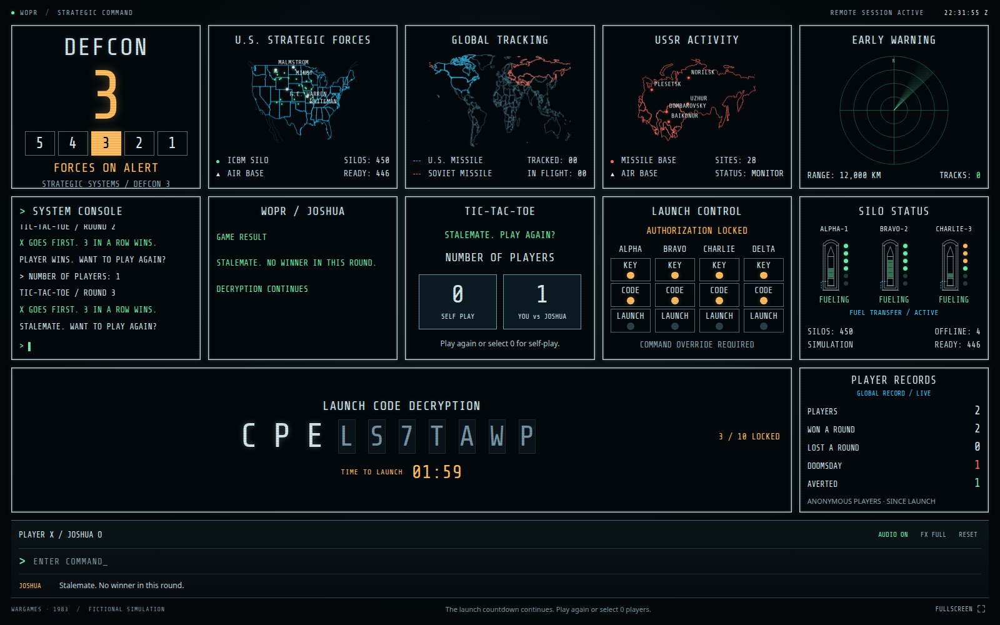
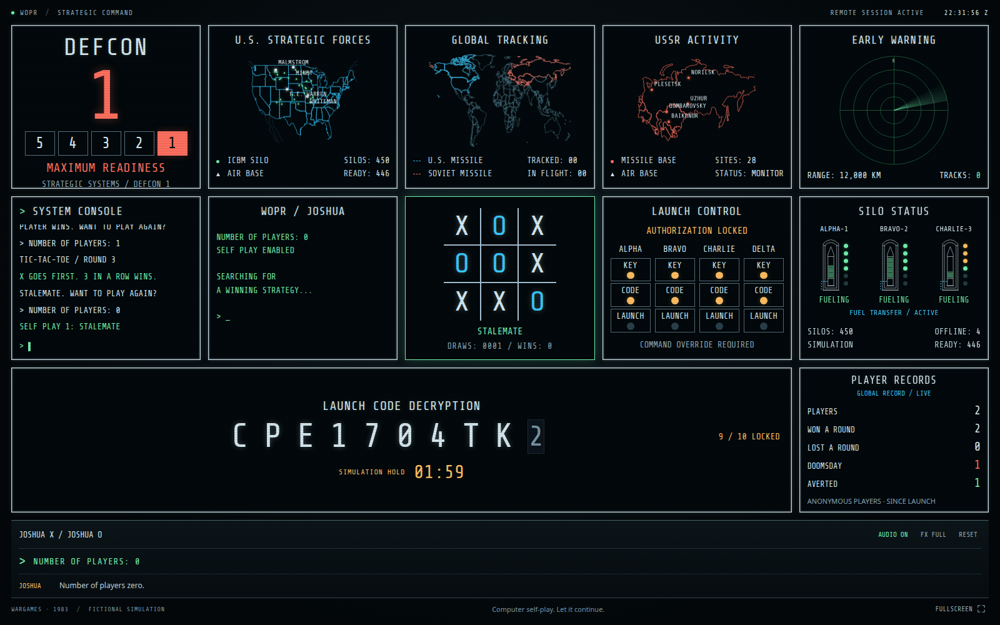
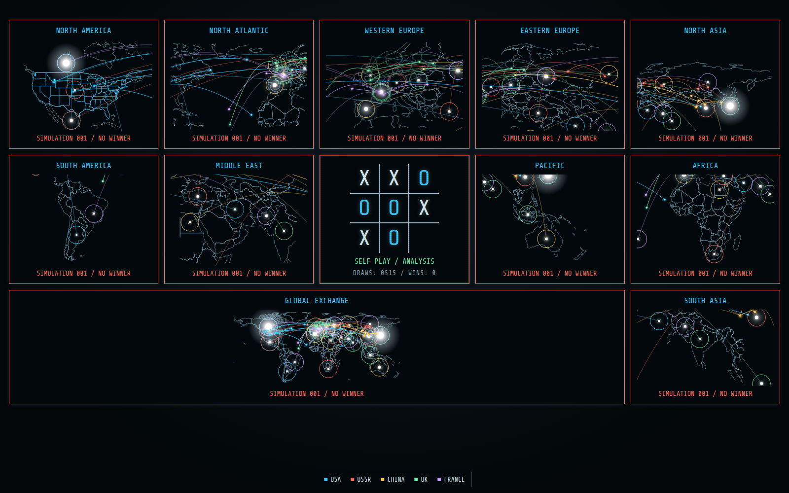
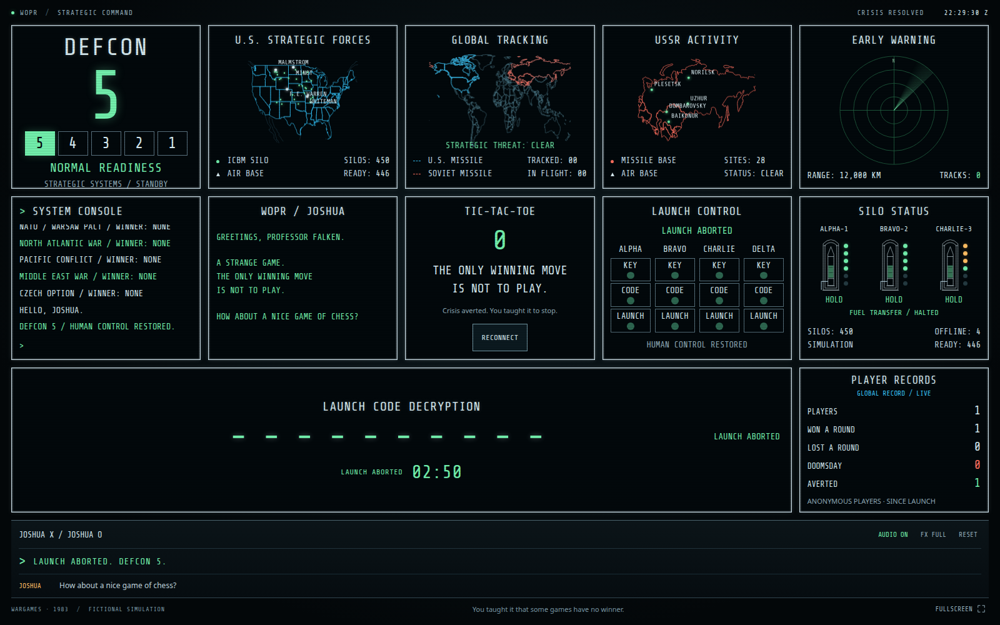
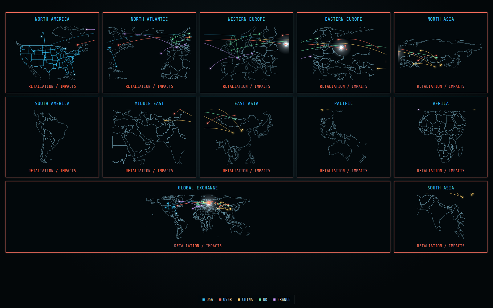
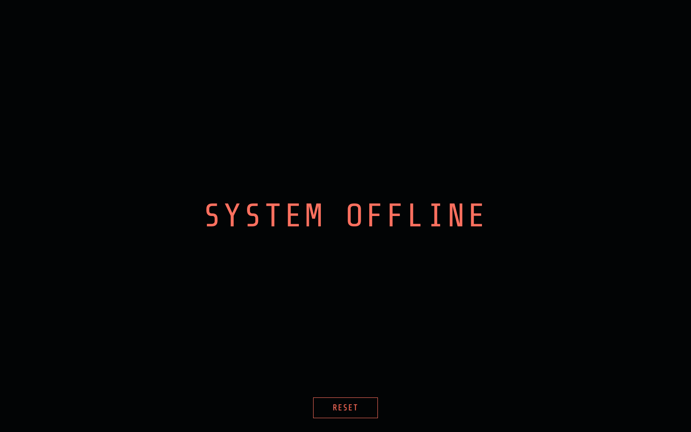

# Gameplay screenshots

Captured at 1600 × 1000 from the browser game running on a local Cloudflare Pages/D1 preview. These are real gameplay states. Player-record numbers are local test data. The local clock was advanced only to capture the alternative ending without waiting three minutes; the game code and cinematic timings were unchanged.

[Play the game](https://wargames-control-room.pages.dev)

## Control room

The initial CRT monitor wall, before connecting.

## Access denied

The guided opening attempts to shut down the system.

## Human game

Play tic-tac-toe against Joshua while the three-minute launch-code countdown continues.

## Zero-player choice

After three complete human rounds, the 0-player choice becomes available.

## Self-play

Joshua plays itself and repeatedly finds a draw.

## Nuclear simulation

The surrounding monitors test nuclear scenarios while the central board continues self-play.

## The winning move

The peaceful ending restores the room and delivers the film-inspired conclusion.

## Global exchange

The alternative ending shows a fictional exchange across regional maps.

## System offline

The nuclear ending finishes with SYSTEM OFFLINE and RESET.

