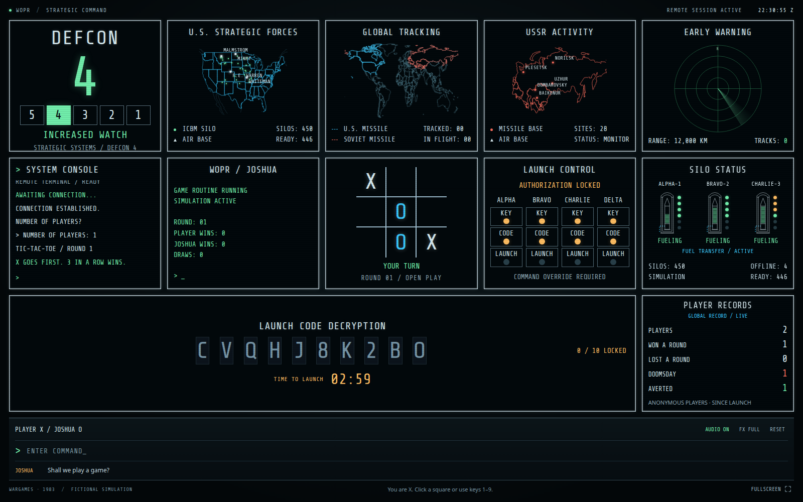

# Social media drafts

## 中文

80後嘅朋友，應該對《WarGames》（1983）有印象。

我用 Codex 整咗一隻受電影結尾啟發嘅網頁遊戲：你坐喺核戰控制室入面，面對一幅 CRT 電視牆、電子聲、發射密碼同三分鐘倒數。你要做嘅，竟然係同超級電腦 Joshua 玩井字過三關。

你可唔可以喺核彈發射之前，令佢明白有啲遊戲根本冇贏家？

「THE ONLY WINNING MOVE IS NOT TO PLAY.」

一路寫、一路測試、一路修改，開發對話紀錄累計處理約 7,000 萬 tokens（包括多輪上下文同快取讀取，唔係純粹生成程式碼嘅數量）。

最諷刺嘅係，呢隻關於 AI 學識停止嘅遊戲，正正係用 AI 寫出嚟。希望佢喺幫我寫 game 嘅過程中，都學到同一個道理：拜託唔好發動核戰。

即刻試玩：https://wargames-control-room.pages.dev

#WarGames #Codex #AI #RetroComputing #井字過三關

## English

This may not be about vintage computers, but then again, maybe it is.

I made a browser game inspired by the ending of WarGames (1983). You're sitting in a nuclear control room, surrounded by CRT-style monitors, electronic speech and a launch-code countdown. Your task is to play tic-tac-toe with Joshua, the supercomputer.

Can you teach it that some games have no winner before the countdown runs out?

“THE ONLY WINNING MOVE IS NOT TO PLAY.”

The irony is that I used AI, through Codex, to write a game about an AI learning when to stop. Hopefully it picked up the lesson while helping me build it. Please don't start a nuclear war.

Play it here: https://wargames-control-room.pages.dev

#WarGames #Codex #AI #RetroComputing #TicTacToe

## Posting assets and token-count note

Use `screenshots/03-human-game.png` as the main image for either post. The [full gallery](screenshots/README.md) contains the opening, human play, zero-player sequence and both endings. Screenshots show genuine states from a local game session; displayed player records are local test data.

The Chinese draft rounds the available cumulative development-conversation counter to approximately 70 million tokens. The last recorded snapshot before the request to create the GitHub repository was 70,290,629 total tokens: 69,897,299 input tokens (including 68,694,272 cached input tokens) and 393,330 output tokens. This includes repeated context and development/testing discussion, not just source-code generation, unique text or a billing estimate. It excludes subsequent repository setup, the Codex Security scan and this fix/gallery task.
